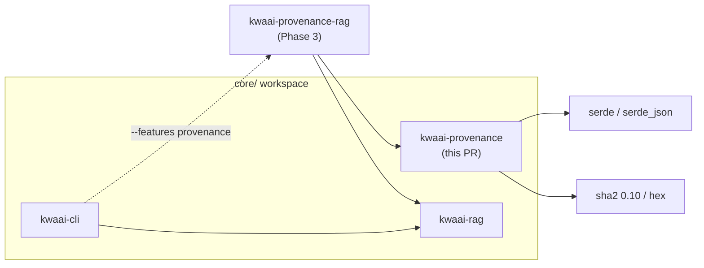
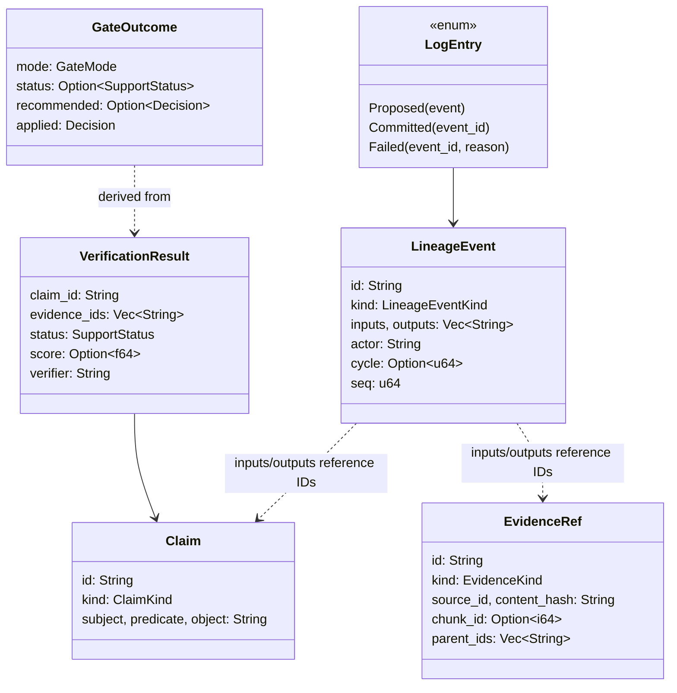
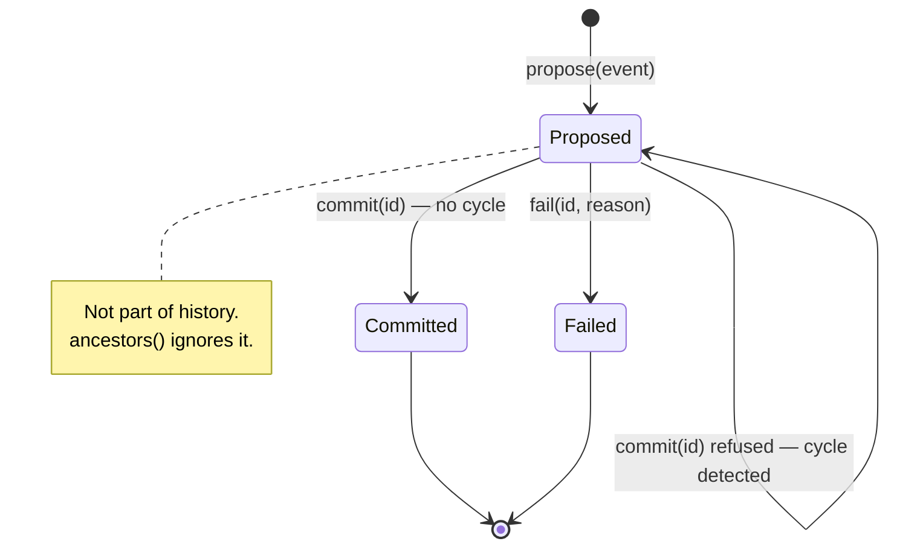
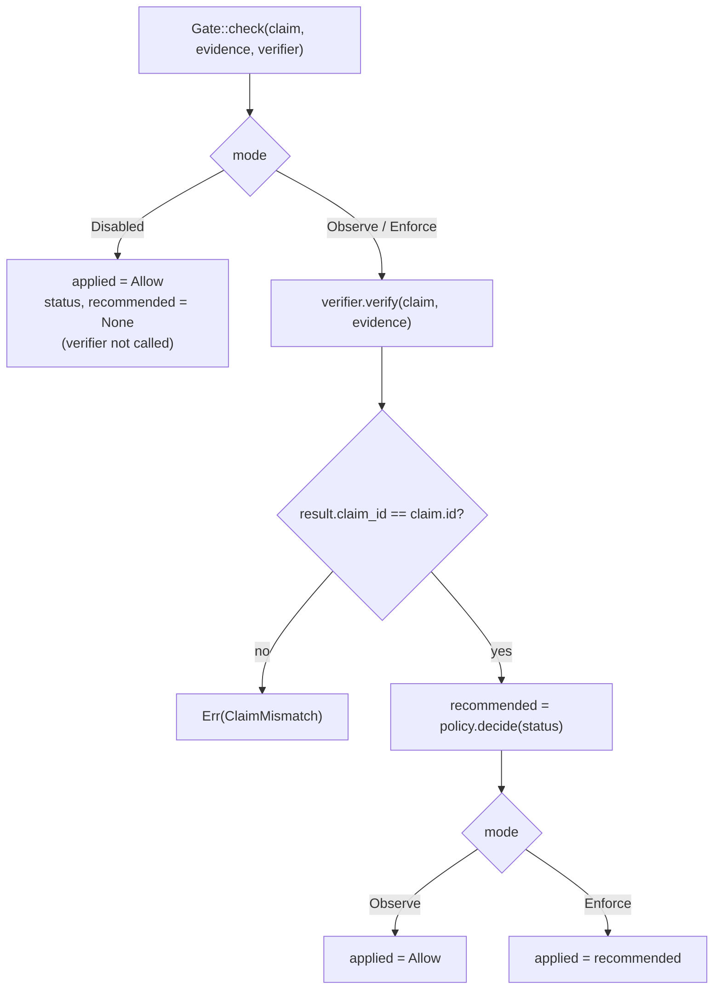
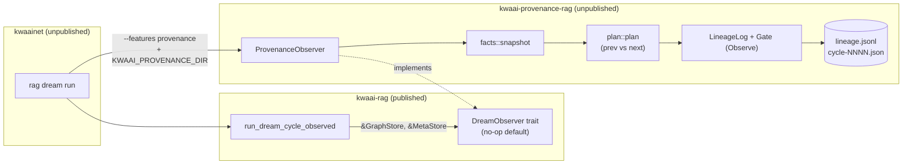
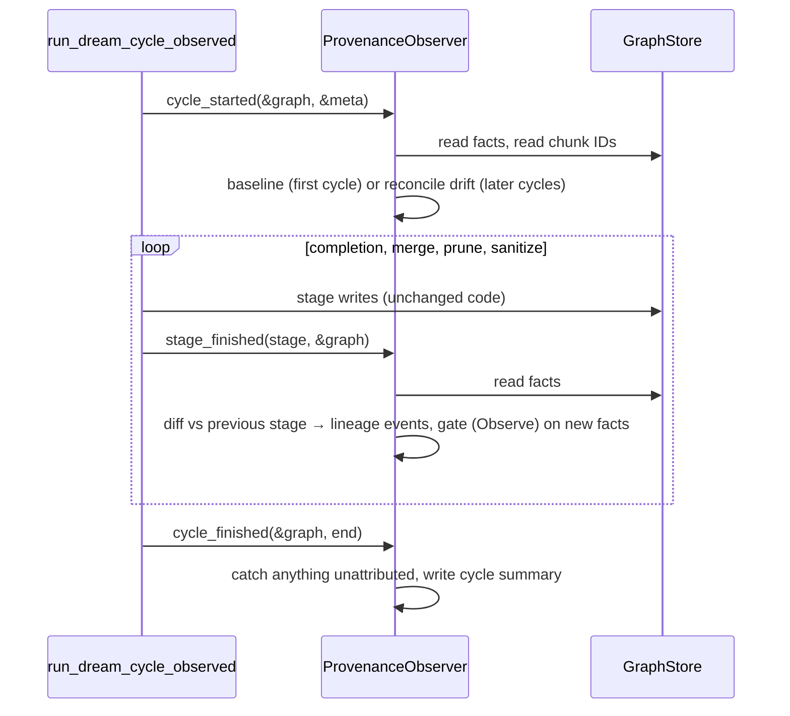
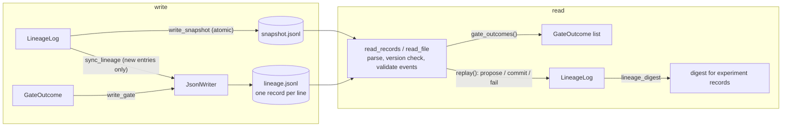

# Native Provenance — Plan and Requirements

**Author:** Jourdane Hamilton
**Crate:** `kwaai-provenance` (`core/crates/kwaai-provenance/`)
**Status:** Phases 1 (standalone primitives) and 2 (JSONL persistence) are in PR #285.
Phase 3 (observe-only dream-cycle adapter) is implemented and tested on a branch
stacked on #285. Phases 4–6 below are proposals and are not implemented.

---

## 1. Context

The knowledge graph associates evidence with facts but does not record whether that
evidence *supports* them, or how a fact was derived. Three properties of the current
`kwaai-rag` code (verified against `main`; symbols, not line numbers):

| Where | What it does today | Why it matters for provenance |
|-------|-------------------|-------------------------------|
| `graph.rs` → `FieldValue` | `confidence = min(1.0, evidence_chunk_ids.len() / 3.0)` | Confidence measures evidence *count*, not semantic support. |
| `dream.rs` → `run_dream_cycle`, relation completion | A dream-added relation takes **all** of the source entity's chunks (`chunks_for_entity`), and falls back to chunk `0` when the entity has none. | Inherited or placeholder chunk IDs look like evidence but are not evidence that the relation is true. |
| `retriever.rs` → `RetrievedChunk.chunk_id: Option<i64>` | `None` marks synthetic results (fact cards, summaries). | Derived content must not be mistaken for an original passage. |

There is also no record of *transformations*: once a dream cycle merges, rewrites or
prunes, the path from a current fact back to its source passage is lost.

## 2. Goals and non-goals

**Goals**

1. Give claims and evidence deterministic, content-derived identities.
2. Record derivations (extract, derive, merge, rewrite, prune) as immutable lineage
   events, with proposed / committed / failed kept distinct.
3. Answer "does this fact still trace to original evidence?" and compute that rate
   across a set of facts — the metric the provenance claim needs.
4. Separate *verification status* (supported / unsupported / unresolved) from the
   *policy decision* (allow / reject / quarantine), with Disabled, Observe and Enforce
   modes that share one verification path.
5. Persist lineage and gate outcomes as JSONL that is re-validated on every read, so
   experiment artifacts are reproducible and a corrupted or edited file is caught.
6. Preserve baseline KwaaiNet behaviour exactly until a later, separately reviewed PR
   opts in.

**Non-goals for this PR**

- Any change to `kwaai-rag`, `kwaai-cli`, or the dream loop.
- Semantic verification (NLI, LLM judge). Only a stub verifier ships.
- A durable quarantine store, file locking, or multi-writer logs.
- Replacing the Python provenance harness used for research; it stays a separate control.

## 3. Requirements

Functional requirements are numbered so the test plan (§8) can trace them.

| ID | Requirement |
|----|-------------|
| FR-1 | Identical claims (kind, subject, predicate, object) get identical IDs; any difference, including kind, changes the ID. |
| FR-2 | Evidence IDs are deterministic and change when the content version (hash) changes. |
| FR-3 | Hash encoding is length-prefixed and domain-separated, so concatenation cannot collide. |
| FR-4 | A lineage event's ID covers kind, inputs, outputs, actor, cycle and sequence; input/output order and duplicates do not change it; mutation state is excluded. |
| FR-5 | Malformed events are rejected: no inputs; no outputs (except prune); prune with outputs; empty IDs; self-derivation; non-canonical lists; stored ID ≠ recomputed ID. |
| FR-6 | Only committed events contribute to ancestry. Proposed and failed events never do. |
| FR-7 | State transitions are one-way (proposed → committed or failed); duplicates and unknown IDs are errors. |
| FR-8 | A commit that would make an artifact its own ancestor is refused and leaves the event proposed. |
| FR-9 | An artifact may have several derivation paths; all are retained. |
| FR-10 | Ancestry, roots and "traces to original" are queryable. Lineage that ends at a synthetic or unknown artifact is not traceable. |
| FR-11 | Prune is recorded without erasing the pruned artifact's lineage. |
| FR-12 | A traceability rate over a set of artifacts is computable; an empty set yields no value rather than 0 or 1. |
| FR-13 | Log entries and gate outcomes serialize to single-line JSON (JSONL) and round-trip. |
| FR-14 | Disabled mode never calls the verifier and always allows. |
| FR-15 | Observe mode calls the verifier, records the policy recommendation, and always allows. |
| FR-16 | Enforce mode applies the policy. Default: Supported → Allow, Unsupported → Reject, Unresolved → Quarantine. The mapping is configurable. |
| FR-17 | Observe and Enforce produce the same status and recommendation for the same input. |
| FR-18 | A verifier result for a different claim is an error, not a decision. |
| FR-19 | No bundled verifier reports Supported; evidence association alone never yields Supported. |
| FR-20 | Lineage entries and gate outcomes persist as JSONL, one record per line, each tagged with its kind and schema version. |
| FR-21 | Reading rebuilds the log by replaying entries through `propose` / `commit` / `fail`; the result has the same entries, ancestry and digest as the log that was written. |
| FR-22 | A tampered event, an invalid transition, a cycle, an unknown schema version or a malformed line is an error naming its line number. |
| FR-23 | A torn final line is an error by default and is dropped only on explicit request (`TailPolicy::DropTornTail`), which reports that it did so. A malformed line anywhere else is always an error. |
| FR-24 | Appending to a file that does not end in a newline is refused; `truncate_torn_tail` repairs it explicitly. |
| FR-25 | Incremental writes add only entries not yet written, so persisting after every mutation never duplicates. |
| FR-26 | `lineage_digest` is a deterministic, order-sensitive SHA-256 fingerprint of a log's entries. |
| FR-27 | `write_snapshot` writes the full log atomically (temporary file, sync, rename) and returns its digest. |

| ID | Non-functional requirement |
|----|----------------------------|
| NFR-1 | The crate does not depend on `kwaai-rag` or any other KwaaiNet crate. |
| NFR-2 | Deterministic: ordered collections throughout; no clocks, randomness or I/O. |
| NFR-3 | No `unsafe` and no network. Filesystem access only in `persist`, only at paths the caller passes. |
| NFR-4 | Every public item is documented; the crate-level example compiles as a doctest. |
| NFR-5 | Passes the repository CI gates: fmt, clippy `-D warnings`, tests on all platforms, Windows `cargo check`, memory integrity, orphaned docs. |
| NFR-6 | Not published to crates.io (`publish = false`) while experimental. |

Phase 3 (observe-only dream-cycle adapter):

| ID | Requirement |
|----|-------------|
| FR-28 | `kwaai-rag` exposes read-only hooks (`DreamObserver`) at cycle start, after each stage that can change the graph (completion, merge, prune, sanitize) and at cycle end. Hooks take the graph by shared reference and return nothing. |
| FR-29 | `run_dream_cycle` keeps its signature and behaviour, using a no-op observer. |
| FR-30 | Observing a cycle leaves the graph exactly as an unobserved cycle leaves it. |
| FR-31 | Every relation and non-empty field value is a fact. The first observed cycle records existing facts as `baseline`; each stage's differences are recorded as extract, evidence-added, rewrite (merge or field-value change) or removal. |
| FR-32 | A chunk ID absent from the chunk store (including the placeholder `0`) is synthetic and never counts as source text. |
| FR-33 | Changes between observed cycles are recorded as `untracked` and reported as drift. |
| FR-34 | Each cycle writes a summary: facts, traceable facts, traceability rate, breakdown by origin, changes per stage, drift, Observe-mode gate counts, lineage digest. |
| FR-35 | An observer error or panic never reaches the cycle; the cycle's summary is marked incomplete with the reason. |
| FR-36 | A provenance directory belongs to one KB; another KB, or a log that does not replay, is refused and the cycle runs unobserved. |
| FR-37 | Off unless `kwaainet` is built with `--features provenance` and `KWAAI_PROVENANCE_DIR` is set. |
| FR-38 | A report tool replays the log, checks it against the latest summary's digest, and prints a per-cycle table or CSV. |

| ID | Non-functional requirement |
|----|----------------------------|
| NFR-7 | `kwaai-rag` gains no dependency, so it stays publishable. The adapter is a separate unpublished crate (`kwaai-provenance-rag`). |
| NFR-8 | The adapter is a default workspace member, so CI builds and tests it without feature flags. |

## 4. Design

### 4.1 Where it sits



`kwaai-provenance` depends only on serialization and hashing crates. Nothing in the
workspace depends on it yet, so this PR cannot change runtime behaviour.

### 4.2 Data model



### 4.3 Mutation lifecycle



Each transition is a new `LogEntry`; nothing is edited in place. The event ID excludes
state, so the same event is identifiable across all three entries.

### 4.4 Gate decision



`GateOutcome::would_block()` reports whether Enforce would have changed the outcome,
which is the observation signal for measuring false rejections before anything is enforced.

### 4.5 Dream-cycle observation (Phase 3)





Observation reads the graph after each stage rather than instrumenting each write, so
it sees every change a stage made, including those inside `merge_entity_into` and
`sanitize_relations`, which report only counts. `dream.rs` gains only the hook calls;
no existing line changed.

### 4.6 Persistence (Phase 2)



Each line is a tagged record:

```text
{"record":"lineage","schema_version":1,"entry":{"entry":"committed","event_id":"…"}}
{"record":"gate","schema_version":1,"outcome":{"mode":"observe","claim_id":"…",…}}
```

A run appends as it goes (`JsonlWriter::append_to`, then `sync_lineage` after each
mutation). A later run or an analysis script reads the file back with `read_file` and
`replay()`, which applies every entry through the same API the run used. After a crash,
`read_file` with `TailPolicy::DropTornTail` reports a torn final line, and
`truncate_torn_tail` removes it before appending resumes.

## 5. Decisions

**D0 — A new crate, not a module in `kwaai-rag`.** The point of provenance is to
judge what the pipeline produced, so it should not live inside the pipeline. A
separate crate keeps the evaluation baseline clean (nothing in `kwaai-rag` changes
until the Phase 3 adapter), can be reviewed and tested on its own, and keeps the
dependency one-way: `kwaai-rag` may depend on it later, never the reverse. The cost
is one more workspace member and an adapter to write.
*Rejected:* a `provenance` module inside `kwaai-rag` — smaller today, but it puts
the measuring code inside the system being measured, and the Phase 3 diff becomes
harder to separate from baseline behaviour.

**D1 — Lineage identity is separate from artifact identity.** Evidence and claim IDs
identify *what* an artifact is; lineage events record *how* it was derived. The same
artifact can be reached by several derivations without changing its ID.
`EvidenceRef.parent_ids` is kept for compatibility but is informational and is not read
by the lineage log; the log is the authoritative derivation record.
*Rejected:* hashing parents into the evidence ID — it makes identical content reached
two ways look like two artifacts.

**D2 — State is not part of the event ID.** A proposal and its commit refer to one ID.
Commit and failure are appended entries, so the log is append-only and a failed graph
write can never appear as history.

**D3 — Entity merges and claim rewrites are distinct event kinds.** Merging two graph
entities is not evidence that any claim about them is supported.

**D4 — Status and decision are separate types.** Verifiers produce a `SupportStatus`;
`Policy` maps it to a `Decision`. Changing policy never requires re-verifying.

**D5 — One verification path for Observe and Enforce.** Observation results are only
predictive of enforcement if both modes run the same code.

**D6 — The bundled verifier is `UnresolvedVerifier`.** It cannot be mistaken for a
real one. Enforce mode with it quarantines everything, which is the safe failure.

**D7 — Local hashing in `lineage.rs`.** The module uses its own length-prefixed SHA-256
helper with a distinct domain (`kwaai-provenance:lineage-event:v1`) rather than coupling
to `identity::hash_parts`, so either can change without silently changing the other's IDs.

**D8 — `sha2` 0.10.** Same major as `kwaai-rag`, so the workspace compiles one `sha2`.

**D9 — Replay through the public API, not deserialization into internal state.** A file
is trusted exactly as much as a caller: every entry goes through `propose` / `commit` /
`fail`, so validation, transition rules and cycle checks are enforced in one place.
*Rejected:* serializing the log's internal maps — faster to load, but a hand-edited or
corrupted file could load into a state the API can never produce.

**D10 — Strict reading; data loss only on explicit request.** An analysis that silently
skipped bad lines would report numbers from a different history than the run produced.
The one recoverable case, a torn final line, is dropped only when the caller asks and is
reported when it happens; repairing the file is a separate, explicit call.

**D12 — Observe by diffing graph state after each stage, not by wrapping each write.**
The proposed design (record a proposed event before each write, then commit or fail it)
would have needed changes at every write site in `dream.rs`, `graph.rs` and the merge and
sanitize internals. Diffing facts after each stage needs one read-only call per stage,
sees changes made deep inside `merge_entity_into` and `sanitize_relations`, and leaves
the cycle's code untouched. Cost: events are recorded after the write, so all are
committed; a failed write leaves no trace in lineage (it is in `cycle_errors`), and a
change that a stage made and undid within itself is invisible.

**D13 — Hooks in `kwaai-rag`, implementation in a separate crate.** `kwaai-rag` is
published to crates.io, and a published crate cannot depend on an unpublished one, even
optionally. So `kwaai-rag` gets a dependency-free trait, and `kwaai-provenance-rag`
(unpublished) implements it. `kwaainet` is unpublished, so it can depend on the adapter
behind a feature. The trait is general (any read-only observer), not provenance-specific.
*Rejected:* a cargo feature in `kwaai-rag` with an optional `kwaai-provenance`
dependency — it breaks `cargo publish -p kwaai-rag`, or forces `kwaai-provenance` to be
published before it is reviewed.

**D14 — Facts are relations and non-empty field values.** They are what the graph stores
evidence for. Descriptions are prose rebuilt from fields; schema types and embeddings
carry no evidence. Entities appear inside claims by graph ID, so a merge changes a fact's
claim ID and is recorded as a rewrite, which is what keeps a merged fact's history.

**D15 — Baseline, then drift.** The first observed cycle records what is already there as
`baseline`, so ingested facts have lineage to their chunks. A later cycle first reconciles
the log with the graph and records anything changed in between as `untracked`. Without
this, re-ingesting or running one cycle unobserved would silently mix unobserved history
into the numbers.

**D16 — Synthetic chunks.** Answers open question 3: the dream cycle's placeholder chunk
`0`, and any chunk ID not in the chunk store, is recorded as `synthetic:chunk:N`, so a
fact that depends only on it is untraceable rather than skipped. Open question 5: the
adapter assigns `seq` as a log-wide counter. Open question 6: the log lives wherever
`KWAAI_PROVENANCE_DIR` points, one directory per KB, outside the KB directory so a KB
rebuild cannot delete it.

**D11 — JSONL with a digest, no hash chain.** JSONL is diffable, greppable, appendable and
readable from Python, which matters for Rust/Python parity. `lineage_digest` pins which
history a result came from. A per-line hash chain would add tamper evidence but not
authenticity (anyone can recompute it), so it waits for signed lineage (§7).

**Vocabulary.** *Lineage event*, *traceability* and *provenance gate* are defined in
`GLOSSARY.md` §6. The provenance gate decides whether a proposed graph mutation is
applied; it is distinct from the glossary's *consolidation gate (proposed)*, which decides
when a chunk becomes evictable. A future consolidation gate could use this crate's
traceability queries as one input.

## 6. Compatibility and baseline behaviour

- No existing crate's source changes. The workspace change is one line in
  `core/Cargo.toml` (`members`) plus the resulting `Cargo.lock` entries.
- No crate depends on `kwaai-provenance`, so the `kwaainet` binary is unchanged.
- `publish = false`; the crate is absent from the publish list in
  `.github/workflows/publish-crates.yml`.
- Rollback: revert the PR. Nothing else references the crate.

**Phase 3.** `kwaai-rag` gains one new module (`dream_observer.rs`) and hook calls in
`dream.rs`; no existing line changes and no dependency is added, so it stays publishable.
`run_dream_cycle` keeps its signature and calls the new `run_dream_cycle_observed` with a
no-op observer. `kwaainet` calls `run_dream_cycle_observed`; without
`--features provenance` it passes the no-op observer, so a default build behaves as
before. Rollback: revert the Phase 3 PR; Phases 1–2 do not depend on it.

## 7. Security and data-handling considerations

- **Phase 3 cannot change the graph.** Every hook receives `&GraphStore` / `&MetaStore`;
  the compiler rejects writes through a shared reference. Hooks return nothing, so they
  cannot alter control flow; errors and panics are caught inside the adapter
  (`ProvenanceObserver::guarded`). The equivalence test checks the result directly.
- **Observation cost.** Each stage reads every fact (relations and fields) and the cycle
  start reads every chunk once to hash it. Linear in graph size; acceptable for
  experiments, not measured on large graphs.

- **IDs are integrity checks, not authentication.** SHA-256 IDs detect accidental
  corruption and tampering that does not recompute the hash. Anyone can construct a
  well-formed event with a valid ID; there are no keys or signatures. Signed lineage
  would need `kwaai-trust`.
- **Resource use.** The log is in memory and unbounded. `ancestors()` is a graph walk;
  `commit()` walks each input's ancestry for cycle detection. Fine for experiments,
  not yet bounded for production-sized graphs.
- **Byte-exact identity.** No normalization: `Alice` and `alice` are different claims.
  This avoids silent merges but can split one fact into several IDs.
- **Private corpora.** Claim text and JSONL observation logs contain knowledge-base
  content. Logs produced from a private KB (D6) must follow the same rule as D6 itself:
  never committed to this repository.
- **Files.** `persist` reads and writes only the paths it is given; it does not create
  directories. There is no locking: one writer per file is the caller's responsibility.
  Reads load the whole file into memory.
- **Tamper evidence.** Replay catches edited events (ID mismatch), impossible histories
  (bad transitions, cycles) and malformed lines. It does not catch a consistent rewrite
  of the whole file, or edits to gate-outcome records, which carry no ID.
- No `unsafe`, network access, or deserialization of untrusted input in a
  network-facing path.

## 8. Test plan

Run from `core/`: `cargo test -p kwaai-provenance`. 44 tests: 6 identity, 13 lineage,
8 gate, 16 persist, 1 doctest.

| Requirement | Test(s) |
|-------------|---------|
| FR-1 | `identity::tests::identical_claims_have_identical_ids`, `different_claims_have_different_ids`, `claim_kinds_are_distinct` |
| FR-2 | `identity::tests::evidence_identity_is_deterministic`, `evidence_versions_have_different_ids` |
| FR-3 | `identity::tests::hash_encoding_is_unambiguous`, `lineage::tests::event_id_separates_kind_actor_cycle_seq_and_framing` |
| FR-4 | `lineage::tests::event_id_is_order_independent_and_deterministic`, `event_id_separates_kind_actor_cycle_seq_and_framing` |
| FR-5 | `lineage::tests::shape_validation`, `tampered_or_noncanonical_record_fails_validation` |
| FR-6 | `lineage::tests::proposed_and_failed_events_do_not_enter_history`, crate doctest |
| FR-7 | `lineage::tests::state_transitions_are_one_way` |
| FR-8 | `lineage::tests::commit_rejects_cycles` |
| FR-9 | `lineage::tests::multiple_derivation_paths_to_same_artifact` |
| FR-10 | `lineage::tests::ancestry_through_merge_and_rewrite_reaches_original`, `lineage_that_stops_at_synthetic_input_is_not_traceable` |
| FR-11 | `lineage::tests::prune_is_recorded_without_erasing_history` |
| FR-12 | `lineage::tests::traceability_rate` |
| FR-13 | `lineage::tests::log_entries_round_trip_as_jsonl`, `gate::tests::outcome_serializes_to_jsonl` |
| FR-14 | `gate::tests::disabled_skips_verifier_and_allows` |
| FR-15 | `gate::tests::observe_records_but_never_blocks` |
| FR-16 | `gate::tests::enforce_applies_default_policy`, `custom_policy` |
| FR-17 | `gate::tests::observe_and_enforce_agree_on_recommendation` |
| FR-18 | `gate::tests::verifier_claim_mismatch_is_an_error` |
| FR-19 | `gate::tests::stub_verifier_never_reports_support` |
| FR-20 | `persist::tests::records_carry_kind_and_schema_version`, `gate_outcomes_round_trip_alongside_lineage`, `newline_in_a_reason_stays_on_one_line` |
| FR-21 | `persist::tests::lineage_round_trips_and_replays_to_same_history`, `file_append_reopen_and_snapshot` |
| FR-22 | `persist::tests::tampered_event_is_rejected_with_line_number`, `invalid_transition_on_disk_is_rejected_at_replay`, `cycle_on_disk_is_rejected_at_replay`, `unsupported_schema_version_is_rejected`, `malformed_middle_line_is_an_error_even_when_lenient` |
| FR-23 | `persist::tests::torn_tail_is_strict_error_or_dropped_on_request`, `blank_lines_and_crlf_are_tolerated` |
| FR-24 | `persist::tests::append_refuses_torn_file_until_repaired` |
| FR-25 | `persist::tests::sync_lineage_writes_only_new_entries` |
| FR-26 | `persist::tests::digest_is_deterministic_and_order_sensitive` |
| FR-27 | `persist::tests::file_append_reopen_and_snapshot` |
| — | `persist::tests::missing_file_is_an_io_error` |
| NFR-1 | `cargo tree -p kwaai-provenance` shows no KwaaiNet crate |
| NFR-4 | crate doctest; `RUSTDOCFLAGS="-D warnings" cargo doc -p kwaai-provenance --no-deps` |
| NFR-5 | CI on the PR |

Phase 3, run with `cargo test -p kwaai-provenance-rag` (14 unit, 7 integration) and
`cargo test -p kwaai-rag dream_observer` (2):

| Requirement | Test(s) |
|-------------|---------|
| FR-28, FR-29 | `kwaai_rag::dream_observer::tests::empty_kb_reports_start_and_nothing_to_do_and_matches_unobserved_run` |
| FR-30 | `observer::observing_does_not_change_the_graph` |
| FR-31 | `plan::tests::*` (11), `observer::records_baseline_dream_changes_and_traceability` |
| FR-32 | `facts::tests::chunk_artifacts_mark_placeholders_synthetic`, `records_baseline_dream_changes_and_traceability` |
| FR-33 | `observer::second_cycle_reconciles_unobserved_changes_as_drift` |
| FR-34 | `records_baseline_dream_changes_and_traceability`, `a_cycle_with_no_changes_still_advances_the_cycle_number` |
| FR-36 | `observer::refuses_another_kbs_directory`, `refuses_a_corrupted_lineage_file_and_env_falls_back_to_noop` |
| FR-38 | `observer::report_tool_prints_cycles_and_detects_a_changed_log` |
| FR-35 | By construction (`guarded`); no test injects a panic |
| FR-37 | `cargo check -p kwaainet --all-targets` with and without `--features provenance` |

**What these tests do not show:** semantic correctness of any verifier, behaviour on
real dream-cycle data, performance at graph scale, or Rust/Python parity. Those belong to
Phases 3–6.

## 9. Limitations

1. Persistence is single-writer with no locking; reads load the whole file; a snapshot
   is a full rewrite, not an incremental checkpoint; gate-outcome records are not
   cross-checked against lineage.
2. No semantic verifier. Enforce mode with the stub quarantines every claim.
3. Quarantine is a decision value only; there is no quarantine store or review flow.
4. Claim IDs carry no tenant / knowledge-base namespace.
5. No string normalization policy (case, whitespace, Unicode).
6. `EvidenceRef` constructors take `content_hash` from the caller and do not compute or
   check it; deserialized `Claim`/`EvidenceRef` records are not checked against their IDs.
   (Deserialized `LineageEvent`s are, via `validate()`.)
7. Artifact IDs in lineage events are opaque strings; the log does not know whether an ID
   is a claim, evidence or entity. Callers supply `is_original`.
8. Unbounded memory and unbounded graph walks (§7).
9. `schema_version` is checked for exact equality; there is no migration path yet for
   reading files written by a future schema.
10. Phase 3 tests drive the dream cycle's graph operations directly; the LLM steps cannot
    run offline, so no test runs a full `run_dream_cycle` with completions. The observed
    and unobserved paths differ only by the hook calls, but a full-cycle comparison on a
    real KB with a fixed model is still to be done (LLM output varies between runs, so it
    has to compare against a recorded completion set, not a second live run).
11. Phase 3 records only applied changes: failed writes, and changes a stage makes and
    reverts within itself, do not appear in lineage.
12. Descriptions, schema types and entity existence are not tracked as facts.
13. Dream-added relations are traceable by association (inherited entity chunks), not
    shown to be supported. Separating the two needs Phase 4.
14. The `provenance` feature path in `kwaainet` is not built by default CI (CI builds
    default features); the adapter crate itself is.

## 10. Rollout

| Phase | Scope | State |
|-------|-------|-------|
| 1 | Standalone primitives: identity, lineage log, gate, docs | **This PR** |
| 2 | Persistence: append-only JSONL writer/reader for `LogEntry` and `GateOutcome`, replay-validated on read; torn-tail handling; atomic snapshots; digest | **This PR** |
| 3 | Observe-only adapter: read-only hooks in `kwaai-rag`, `kwaai-provenance-rag` adapter, `kwaainet --features provenance`, report tool | **Implemented**, stacked on #285 |
| 4 | Opt-in evidence verification: `EvidenceBackend` trait with a mock and an optional Ollama backend (`ollama` feature), original-evidence resolution from the chunk store (read-only), `provenance-verify` CLI (`verification` feature). Calibration against labelled data is **deferred**: no independently labelled set exists yet | **Implemented**, stacked on Phase 3; uncalibrated |
| 5 | Shadow gating **without enforcement**: three hypothetical policies (`Allow`, `RejectUnsupported`, `RequireSupported`) evaluated over the same retained Phase 4 assessments, with attributed, serializable decisions (`shadow` modules, `provenance-shadow` CLI). The policy engine has no graph mutation handle; no write is blocked, reordered, rewritten or suppressed | **Implemented**, stacked on Phase 4; shadow only |
| Deferred | Enforce mode and a durable quarantine store (originally Phase 5): applying the policy to graph writes, a quarantine store beside the lineage log, and a review/release command. Needs a decision on whether the hook gets write access or returns a decision `dream.rs` respects | **Deferred**; not proposed until Observe and shadow data show the false-rejection rate, and Reza and Chris agree on #284 |
| 6 | Evaluation framework (`kwaai-provenance-eval`): corpus manifests, reproducible sampling, independent annotations, metrics with Wilson intervals, resumable runs with implementation fingerprints, and strict import of Phase 5 shadow records. Target measures: traceability after N cycles, unsupported-fact rate, false-rejection rate, recall@k cost of gating, gate-before vs. gate-after consolidation, Rust/Python parity, reproducible JSONL artifacts | **Framework implemented**, stacked on Phase 5; validated on synthetic fixtures only. No empirical evaluation has run: the target measures need real runs, independent annotations and a fixed corpus/model protocol |

Phases 1 and 2 ship together because both stay inside the crate. Each later phase is
its own PR. Enforcement (deferred; originally Phase 5) is not proposed until Observe data from
Phase 3 shows the false-rejection rate.

## 11. Open questions

1. **Namespace.** Should claim IDs include the KB's `tenant_id`? Doing so is a schema
   version bump (v2) and changes every ID.
2. **Normalization.** Should claim identity follow the graph's name normalization
   (`find_by_name_normalized`), or stay byte-exact and leave merging to lineage events?
3. **Chunk `0` fallback.** In Phase 3, should a dream relation whose evidence is the
   placeholder `0` be recorded as derived from a synthetic artifact (untraceable), or
   skipped? *Answered in Phase 3 by D16.*
4. **Entity IDs.** The glossary notes entity type is part of the entity ID hash. When a
   dream cycle reclassifies a type, is that an `EntityMerge` or a new event kind?
5. **Sequence numbers.** Who assigns `seq` in Phase 3 — the adapter (per cycle) or the
   graph store? *Answered in Phase 3 by D16.*
6. **Log location.** Under the KB directory beside the graph, or a separate experiment
   output directory? *Answered in Phase 3 by D16.*